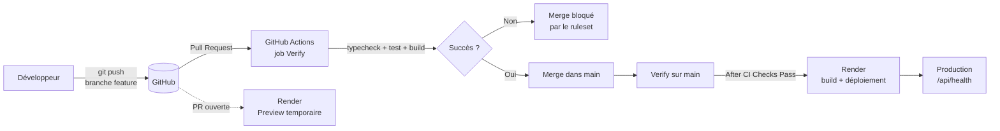
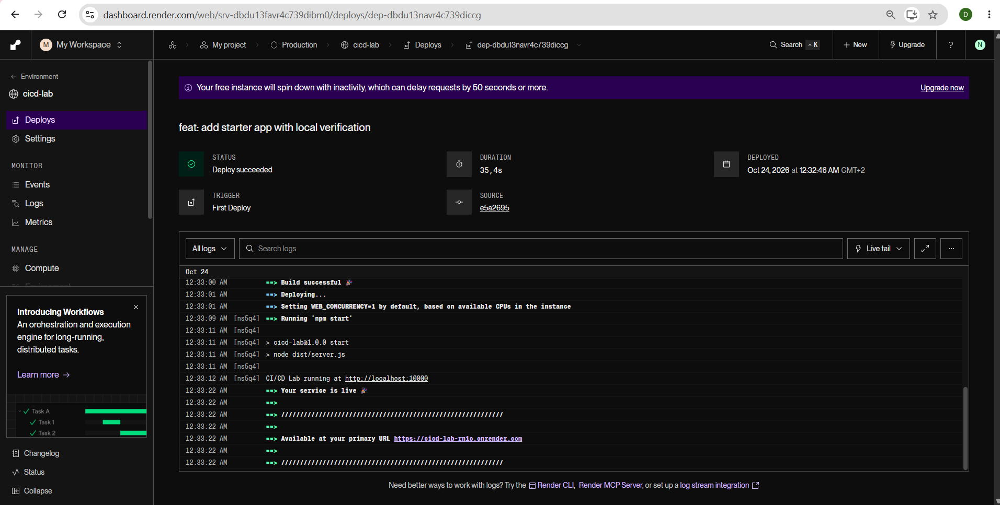
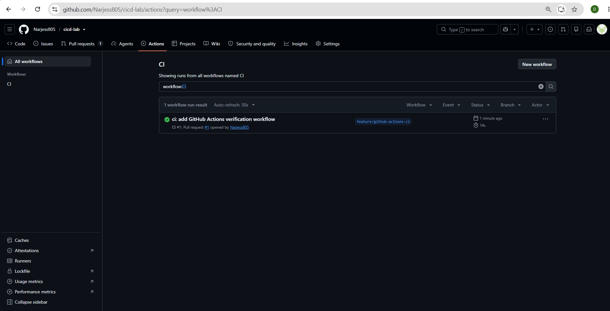
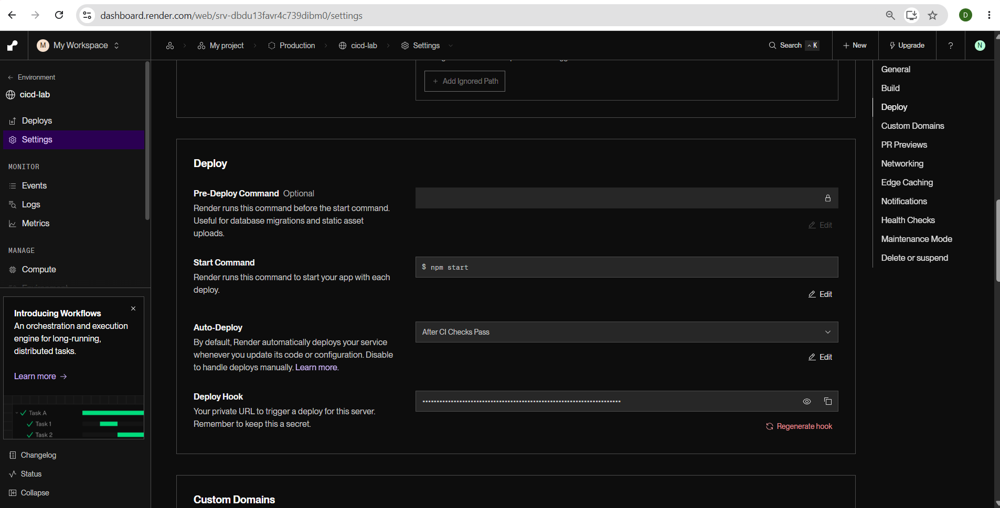
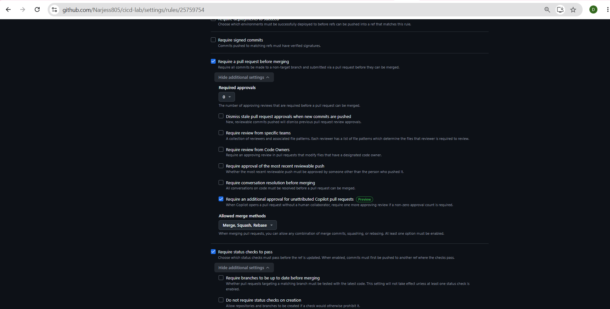
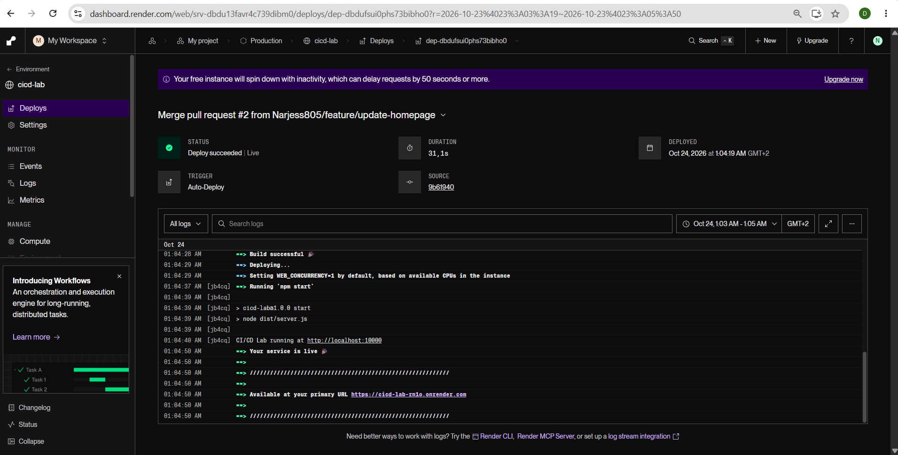
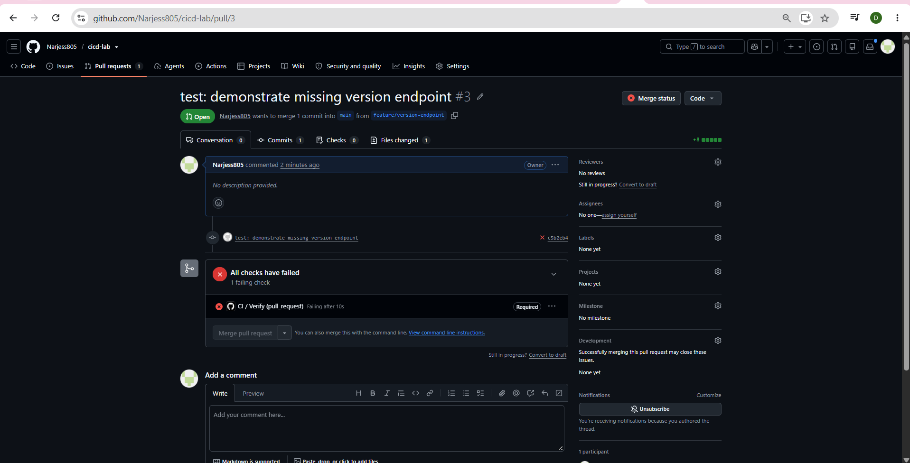
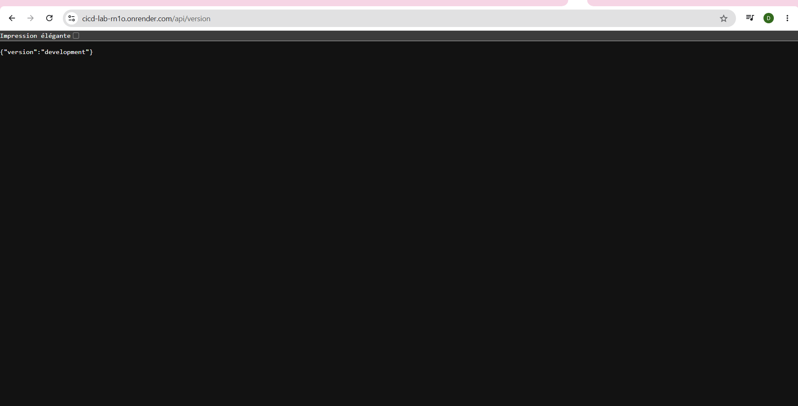

#  TP3 — CI/CD avec GitHub Actions et Render


> Pipeline CI/CD complet pour une application **Express / TypeScript** : vérifications automatiques avec **GitHub Actions**, déploiement conditionné au succès des checks sur **Render**, protection de la branche `main` par **ruleset** et déploiements de prévisualisation par Pull Request.

| | |
|---|---|
| **Étudiante** | Narjess Dabbech |
| **Formation** | Master DevOps & Cloud (M2) |
| **Dépôt GitHub** | https://github.com/Narjess805/cicd-lab |
| **Production (Render)** | `https://<votre-service>.onrender.com` |
| **Date** | Octobre 2026 |

---

##  Sommaire

1. [Objectifs](#1--objectifs)
2. [Architecture du pipeline](#2--architecture-du-pipeline)
3. [Application](#3--application)
4. [Mise en place](#4--mise-en-place)
5. [Intégration continue : GitHub Actions](#5--intégration-continue--github-actions)
6. [Déploiement continu : Render](#6--déploiement-continu--render)
7. [Protection de la branche `main`](#7--protection-de-la-branche-main)
8. [Scénarios de validation](#8--scénarios-de-validation)
9. [Captures d'écran](#9--captures-décran)
10. [Comparaison avec le TP2](#10--comparaison-avec-le-tp2-coolify-vs-github-actions--render)
11. [Difficultés rencontrées](#11--difficultés-rencontrées)
12. [Livrables](#12--livrables)

---

## 1.  Objectifs

- Cloner, vérifier et déployer une petite application Express / TypeScript
- Automatiser le typecheck, les tests et le build avec **GitHub Actions**
- Déployer sur **Render** uniquement après le succès de la CI
- Interdire le merge sur `main` sans Pull Request et sans check `Verify` réussi
- Démontrer un test en échec, un changement validé et une **prévisualisation de Pull Request**

---

## 2.  Architecture du pipeline



**Principe** : aucun code n'atteint la production sans avoir passé la CI, et aucun merge n'est possible tant que le check `Verify` n'est pas vert.

---

## 3.  Application

Application Express / TypeScript (Node.js 24) avec les scripts npm suivants :

| Script | Commande | Rôle |
|---|---|---|
| `dev` | `tsx watch src/server.ts` | Développement local |
| `typecheck` | `tsc --noEmit` | Vérification des types |
| `test` | `node --import tsx --test test/app.test.ts` | Tests automatisés |
| `build` | `tsc` | Compilation vers `dist/` |
| `start` | `node dist/server.js` | Démarrage en production |
| `verify` | `npm run typecheck && npm test && npm run build` | Toutes les vérifications |

**Endpoints**

| Méthode | Route | Réponse |
|---|---|---|
| `GET` | `/` | Page d'accueil HTML |
| `GET` | `/api/health` | `{"status":"ok"}` |
| `GET` | `/api/version` | `{"version":"development"}` (sans `APP_VERSION`) |

---

## 4.  Mise en place

```bash
git clone https://github.com/wahid007/cicd-lab-starter.git cicd-lab
cd cicd-lab
rm -rf .git && git init -b main      # historique propre
node --version                       # doit commencer par v24.
npm ci
npm run dev                          # http://localhost:3000
npm run verify                       # typecheck + test + build
```

Publication sur GitHub (dépôt **public**, sans README, licence ni gitignore) :

```bash
git add .
git commit -m "feat: add starter app with local verification"
git remote add origin https://github.com/Narjess805/cicd-lab.git
git push -u origin main
```

---

## 5.  Intégration continue : GitHub Actions

Fichier `.github/workflows/ci.yml`, déclenché sur les Pull Requests vers `main` et les pushs sur `main` :

```yaml
name: CI

on:
  push:
    branches: [main]
  pull_request:
    branches: [main]

permissions:
  contents: read

jobs:
  verify:
    name: Verify
    runs-on: ubuntu-latest
    timeout-minutes: 10
    steps:
      - name: Check out repository
        uses: actions/checkout@v4

      - name: Set up Node.js
        uses: actions/setup-node@v4
        with:
          node-version: 24
          cache: npm

      - name: Install dependencies
        run: npm ci

      - name: Verify application
        run: npm run verify
```

Le workflow reproduit exactement les commandes exécutées en local (`npm ci` puis `npm run verify`), ce qui rend les résultats prévisibles.

---

## 6.  Déploiement continu : Render

| Paramètre | Valeur |
|---|---|
| Type | Web Service (Node) |
| Dépôt / branche | `Narjess805/cicd-lab` / `main` |
| Instance | Free |
| Build Command | `npm ci && npm run build` |
| Start Command | `npm start` |
| Health Check Path | `/api/health` |
| Auto-Deploy | ~~On Commit~~ → **After CI Checks Pass** |

Le passage de *On Commit* à *After CI Checks Pass* garantit que chaque push sur `main` n'est déployé qu'après la réussite de `Verify`.

---

## 7.  Protection de la branche `main`

Ruleset **Protect main** (*Settings → Rules → Rulesets*) :

| Paramètre | Valeur |
|---|---|
| Enforcement | Active |
| Cible | Default branch (`main`) |
| Require a pull request before merging | Activé (0 approbation, projet solo) |
| Require status checks to pass | Activé |
| Check requis | `Verify` (GitHub Actions) |
| Bypass list | Vide |

---

## 8.  Scénarios de validation

| # | Scénario | Branche | Résultat attendu |
|---|---|---|---|
| 1 | Changement normal : message ajouté à la page d'accueil | `feature/update-homepage` | `Verify` vert → merge → déploiement → message visible |
| 2 | Test en échec : test de `/api/version` sans route | `feature/version-endpoint` | `Verify` rouge → merge **bloqué** |
| 3 | Correction : ajout de la route `/api/version` | `feature/version-endpoint` | `Verify` vert → merge → `/api/version` répond |
| 4 | Prévisualisation de la PR | `feature/preview-demo` | URL de preview distincte, production inchangée |

Flux appliqué à chaque scénario :

```bash
git switch -c feature/<nom>
# modification
npm run verify
git add . && git commit -m "<message>"
git push -u origin feature/<nom>
# Pull Request → attente de Verify → Create a merge commit
git switch main && git pull --ff-only && git branch -d feature/<nom>
```

---

## 9.  Captures d'écran

### 9.1 Premier déploiement Render et `/api/health`


### 9.2 Job `Verify` réussi dans GitHub Actions


### 9.3 Auto-Deploy configuré sur « After CI Checks Pass »


### 9.4 Ruleset « Protect main » avec le check `Verify` requis


### 9.5 Page d'accueil mise à jour en production


### 9.6 `Verify` en échec et merge bloqué


### 9.7 Réponse de `/api/version` après déploiement


---

## 10.  Comparaison avec le TP2 (Coolify vs GitHub Actions + Render)

| Critère | TP2 — Coolify + Forgejo | TP3 — GitHub Actions + Render |
|---|---|---|
| Hébergement | Auto-hébergé (VM locale) | Cloud (SaaS) |
| Déclencheur | Webhook direct de Forgejo | Workflow GitHub Actions |
| Build | Nixpacks / Dockerfile | Scripts npm (`npm ci && npm run build`) |
| Intégration continue | Aucun test automatisé natif | Workflow complet (typecheck, tests, build) |
| Protection de branche | Manuelle ou inexistante | Rulesets GitHub (PR + `Verify` obligatoires) |
| Prévisualisation des PR | Non gérée par défaut | Intégrée (Render PR Previews) |
| Infrastructure | VM, RAM, Docker à administrer | Aucune, entièrement gérée |
| Contrôle des données | Total | Limité au fournisseur |

**Conclusion** : Coolify convient pour garder la maîtrise de l'infrastructure et des données ; GitHub Actions + Render offre une solution « zéro maintenance » avec des garde-fous de qualité intégrés.

---

## 11.  Difficultés rencontrées

| Problème | Cause | Solution |
|---|---|---|
| Version des actions GitHub | Le sujet mentionnait `actions/checkout@v7` et `setup-node@v7` | Utilisation de `@v4`, version stable connue et fonctionnelle |
| Démarrage de l'application sur Render | L'application doit écouter le port fourni par Render | Utilisation de la variable `PORT` avec les commandes `npm ci && npm run build` et `npm start` |
| Merge direct impossible | Le ruleset exige une Pull Request et le check `Verify` | Passage systématique par une PR, puis attente du succès de la CI |

---

## 12.  Livrables

- [x] Dépôt GitHub public `cicd-lab`
- [x] URL de production Render
- [x] Captures dans `captures/` (7 sur 8)
- [ ] `captures/preview-vs-production.png` : URL de preview et URL de production côte à côte
- [x] Rapport : sections 10 et 11 de ce document (à copier dans `REPORT.md`)

```
.
├── README.md
├── REPORT.md
├── .github/workflows/ci.yml
├── src/
├── test/
└── captures/
    ├── render-first-deploy.png
    ├── actions-verify-pass.png
    ├── render-auto-deploy.png
    ├── ruleset-protect-main.png
    ├── homepage-updated.png
    ├── pr-failing-verify.png
    ├── api-version.png
    └── preview-vs-production.png
```

Test preview deployment.
